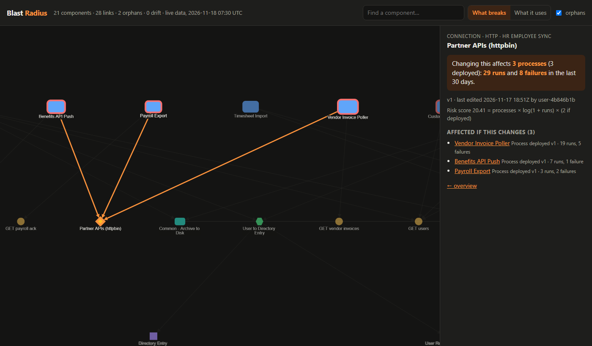
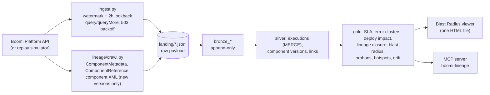
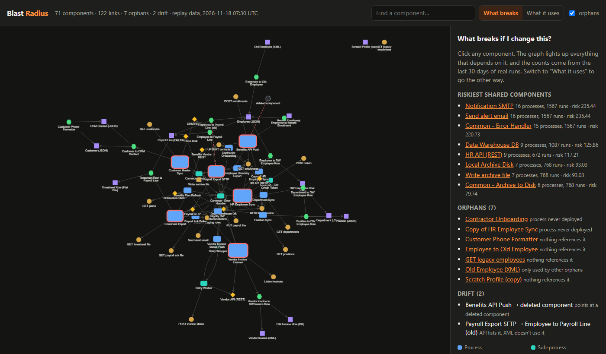

# Boomi Ops Lakehouse

Pulls Boomi run history and component metadata from the **Boomi Platform API** into a **Delta Lake** lakehouse, and answers two questions every Boomi team has:

1. **How are my integrations doing?** SLA, incident and deploy-impact marts from run history.
2. **What breaks if I change this?** *Blast Radius*: a lineage graph of every process, connection, operation, map, profile and sub-process, weighted by real runs and failures.

> **Status:** ingestion, lineage, gold marts, the Blast Radius viewer and an MCP server work end to end, both in **replay mode** (no Boomi account needed) and against a **live Boomi trial account**. Not done yet: Databricks deployment and the triage agent itself.

All data is synthetic or from a personal trial account. No real company, client or person.



## Run it (no Boomi account needed)

```bash
docker compose build
docker compose run --rm cli "pytest -q"
docker compose run --rm cli "python -m boomi_ops.run --data-root data/replay replay --start 2026-11-01 --days 4 --transform end"
docker compose run --rm cli "python -m boomi_ops.run --data-root data/replay lineage show"
docker compose run --rm cli "python -m boomi_ops.run --data-root data/replay lineage viewer --source replay"
```

Then open `data/replay/viewer/index.html` in a browser. CI builds the same page from replay data and publishes it to GitHub Pages.

Replay mode simulates a Boomi account: six demo processes that fail in known ways, inside a 70-component account with shared connections, maps, sub-processes and planted lineage problems. The pipeline talks to it through **the same API client** used in live mode: same query/queryMore paging, same 503 retries.

Live mode: follow [docs/setup.md](docs/setup.md) (Boomi trial, local runtime, API token). Keep live data in its own folder:

```bash
docker compose run --rm cli "python -m boomi_ops.run check"
docker compose run --rm cli "python -m boomi_ops.run --data-root data/live live --since 2026-11-17"
docker compose run --rm cli "python -m boomi_ops.run --data-root data/live lineage crawl"
docker compose run --rm cli "python -m boomi_ops.run --data-root data/live lineage impact 'Partner APIs (httpbin)'"
docker compose run --rm cli "python -m boomi_ops.run --data-root data/live lineage viewer"
```

## How it works



Design decisions worth asking about:

- **Late-arriving status.** A run that's still going shows as `STARTED` (seen on a live account). Each pull re-reads the last 2 hours, and the MERGE rule says a **final status always beats a running one**. So re-loading an old batch can never send a finished run back to "running" (tested).
- **Idempotent ingestion.** The batch id comes from the window end, and the watermark is saved only after the file is written. A crash just repeats a window.
- **Boomi's number quirk.** The schema says `executionDuration` is int64, but responses show `["Long", 3832]`. Bronze keeps the raw JSON, and silver parses both forms (tested).
- **Error fingerprints.** Masking IDs, numbers, quoted values, URLs and emails turns `row 17 ... "31-02-2026"` and `row 802 ... ""` into one incident. HTTP codes and ports are kept, because a 401 isn't a 500. The rules are written once and applied in both Spark and Python, and a test checks they agree.

API details and their sources: [docs/boomi_api_notes.md](docs/boomi_api_notes.md).

## Blast Radius: component lineage

Boomi's "Show Where Used" answers one component at a time, in the UI. Blast Radius crawls the whole account and keeps the answer in the lake.

**What it shows**
- Click any component in the viewer: everything that depends on it lights up, with "changing this affects N processes (D deployed), R runs and F failures in the last 30 days".
- **Orphans:** components no process reaches (including "only used by other orphans"), and processes never deployed.
- **Hotspots:** shared components with the widest reach, weighted by real run volume.
- **Drift:** links the Platform API and the component XML disagree on, links to deleted components, and processes edited but not redeployed.

**Design decisions**
- **Two sources, reconciled.** Links come from `ComponentReference` *and* from parsing every GUID attribute in the component XML (`connectionId`, `operationId`, `mapId`, `processId`, `fromProfile`, `toProfile`). On the live trial they agree on all 28 links; disagreements land in a drift report.
- **References are one level deep** (a process lists its map, not the map's profiles), so the crawler visits every component, and gold builds the **transitive closure** in Spark by semi-naive iteration (Spark SQL has no recursive CTE). Sub-process cycles end the loop on their own; a test checks the result against plain Python.
- **Incremental by version.** A saved Boomi component version never changes, so its links never change. The crawler only fetches references and XML for versions it hasn't seen: a second crawl with no edits is **1 API call**.
- **History Boomi forgets.** The API returns no references for old versions, so `silver_component_versions` and versioned links are the only record of what a process used *before* a deploy (the replay's bad deploy adds a map; the rollback removes it, leaving an orphan).
- **Weighted by reality.** A connection used by 14 processes that never run matters less than one used by 3 that run every 10 minutes. Runs count from top-level processes only, because a sub-process runs inside its parent.
- **Privacy.** `createdBy` / `modifiedBy` hold user emails. The crawler replaces them with a stable pseudonym (`user-<hash>`) before anything is written.



### MCP server for Claude and the triage agent

`python -m boomi_ops.lineage.mcp_server --graph data/live/viewer/lineage.json` serves four read-only tools: `find_component`, `get_blast_radius`, `get_shared_dependencies` and `get_lineage_health`.

`get_shared_dependencies` answers the first triage question: *is this failure something the process shares with others?* It only counts other processes that failed **within an hour** of the failure (stronger when the error fingerprint matches), and it sets aside plumbing that most processes use, like an error-handler sub-process. Over 30 days every busy process fails now and then for its own reasons, so timing is what separates a shared outage from a local bug.

To use it from Claude Code, add this as `.mcp.json` in the repo:

```json
{ "mcpServers": { "boomi-lineage": { "command": "docker",
  "args": ["compose", "run", "--rm", "-T", "cli",
           "python -m boomi_ops.lineage.mcp_server --graph data/live/viewer/lineage.json"] } } }
```

## Results

### Live Boomi trial account (2026-11-18)

| | |
|---|---|
| Components / links | 21 / 28 (API and XML agree on all 28) |
| First crawl / second crawl with no edits | 43 API calls / 1 API call |
| Orphans | 1 unused profile, 1 process never deployed |
| Partner APIs (httpbin) blast radius | 3 deployed processes, 29 runs, 8 failures in 30 days |
| Triage, 06:00 failure of HR Employee Sync | Customer Master Sync failed in the same minute with the same error, and both use JSONPlaceholder HTTP: "probably shared". The host really was unreachable. |
| Triage, Payroll Export / Benefits API Push / Vendor Invoice Poller | each "probably inside" the process (timeouts, a 401, a 503 window), although all three share Partner APIs |

### 4-day replay (seed 7)

| | |
|---|---|
| Components / links / closure rows | 70 / 122 / 196 |
| Planted cases found | 7 orphans (incl. one orphan chain), 2 drift links (stale reference, deleted component), 1 sub-process cycle |
| Daily crawls after the first | 1 to 4 API calls (only the bad deploy and the rollback were new versions) |
| Tests | 67, all passing (unit + Spark/Delta end to end) |

### 7-day replay of run history (seed 7)

| | |
|---|---|
| Simulated runs / failures | 2,699 / 128 |
| Hourly pulls / API calls / retries after a simulated 503 | 338 batches / 394 calls / 56 retries |
| Rows landed (overlap from the 2h lookback) | 8,084 → 2,699 unique in silver |
| Failures → distinct incident fingerprints | 128 → 9 |
| Bad deploy (Customer Master Sync 1.1) | error rate 0% → 68.8% in the next 24h, flagged; rollback 1.2 not flagged |
| Payroll Export SFTP p95 duration | 1,161 s on day 1 → 2,147 s on day 7 (slow-upstream drift) |

Replay numbers show the pipeline works. They are not production measurements.

## Layout

```
src/boomi_ops/
  client.py           Platform API client (paging, retries, rate cap)
  simulator.py        replay-mode run history + ground-truth failure labels
  ingest.py           incremental pull -> landing files
  fingerprint.py      error message -> template -> fingerprint
  lineage/
    crawl.py          component + reference crawl, incremental by version, pseudonymised
    xml_edges.py      links parsed from component XML
    sim_account.py    replay-mode 70-component account with planted lineage problems
    queries.py        blast radius, shared dependencies (triage), health, from lineage.json
    viewer.py         builds the Blast Radius page (viewer_template.html)
    mcp_server.py     MCP server: boomi-lineage tools
    report.py         `lineage show` / `lineage impact` terminal output
  transform/          Spark + Delta: bronze, silver MERGE, gold marts, lineage gold
  run.py              CLI: replay | check | live | lineage crawl/show/impact/viewer | transform
scripts/              trial-account setup (demo processes, lineage demo components)
tests/                unit tests + Spark/Delta end-to-end tests; fixtures from the live trial
```
