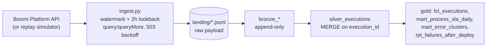

# Boomi Ops Lakehouse

Pulls Boomi process run history from the **Boomi Platform API** into a **Delta Lake** lakehouse and models it into SLA, incident and deploy-impact marts. An AI triage agent (coming in week 4) will then explain each new incident.

> **Status: scaffold.** Ingestion, bronze/silver/gold and tests work end to end in **replay mode**. Not yet done: a run against a real Boomi trial account, Databricks deployment, the dashboard and the agent.

All data is synthetic. No real company, client or person.

## Run it (no Boomi account needed)

```bash
docker compose build
docker compose run --rm cli "pytest -q"
docker compose run --rm cli "python -m boomi_ops.run replay --start 2026-11-01 --days 7"
docker compose run --rm cli "python scripts/show_gold.py"
```

Replay mode simulates a Boomi account with six demo processes, each failing in a known way. The pipeline pulls from it every simulated hour through **the same API client** used in live mode: same query/queryMore paging, same 503 retries.

Live mode: copy `.env.example` to `.env`, fill in an API token, then run `python -m boomi_ops.run live`.

## How it works



Design decisions worth asking about:

- **Late-arriving status.** A run that's still going shows as `INPROCESS`. Each pull re-reads the last 2 hours, and the MERGE rule says a **final status always beats INPROCESS**. So re-loading an old batch can never send a finished run back to "running" (tested).
- **Idempotent ingestion.** The batch id comes from the window end, and the watermark is saved only after the file is written. A crash just repeats a window.
- **Boomi's number quirk.** The schema says `executionDuration` is int64, but responses show `["Long", 3832]`. Bronze keeps the raw JSON, and silver parses both forms (tested).
- **Error fingerprints.** Masking IDs, numbers, quoted values, URLs and emails turns `row 17 ... "31-02-2026"` and `row 802 ... ""` into one incident. HTTP codes and ports are kept, because a 401 isn't a 500. The rules are written once and applied in both Spark and Python, and a test checks they agree.

API details and their sources: [docs/boomi_api_notes.md](docs/boomi_api_notes.md).

## Results from the 7-day replay (seed 7)

| | |
|---|---|
| Simulated runs / failures | 2,699 / 128 |
| Hourly pulls / API calls / retries after a simulated 503 | 338 batches / 394 calls / 56 retries |
| Rows landed (overlap from the 2h lookback) | 8,084 → 2,699 unique in silver |
| Failures → distinct incident fingerprints | 128 → 9 |
| Bad deploy (Customer Master Sync 1.1) | error rate 0% → 68.8% in the next 24h, flagged; rollback 1.2 not flagged |
| Payroll Export SFTP p95 duration | 1,161 s on day 1 → 2,147 s on day 7 (slow-upstream drift) |

These are simulator numbers. They show the pipeline works. They are not production measurements.

## Layout

```
src/boomi_ops/
  client.py        Platform API client (paging, retries, rate cap)
  simulator.py     replay-mode Boomi account + ground-truth failure labels
  ingest.py        incremental pull -> landing files
  fingerprint.py   error message -> template -> fingerprint
  transform/       Spark + Delta: bronze, silver MERGE, gold marts
  run.py           CLI: replay | live | transform
tests/             unit tests + Spark/Delta end-to-end tests
```
